# Timesheet – User Guide

For app version 0.9.7 (beta). **Open the app:** the link shared in your team's WhatsApp group, or scan the QR code on a colleague's phone (Setup → **Share the app**).

The letterhead, project title and names in the screenshots are samples.

**Contents:** [Month-end in 5 steps](#month-end-in-5-steps) · [1. Install and first start](#1-install-and-first-start) · [2. Key in the month](#2-key-in-the-month) · [3. Print](#3-print) · [4. Sign and scan the signed copy](#4-sign-and-scan-the-signed-copy) · [5. Send your timesheet to the compiler](#5-send-your-timesheet-to-the-compiler) · [6. Records and Setup](#6-records-and-setup) · [7. HQ submission (compiler)](#7-hq-submission-compiler) · [8. Good to know](#8-good-to-know)

## Month-end in 5 steps

1. **Fill month**, then tap the days that were different (leave, MC, overtime).
2. **Print / PDF** → print on A4 at actual size.
3. **Sign and stamp by hand**, then the PYKP and SOR verification.
4. **Scan signed copy** to keep it on your phone.
5. Hand in the hardcopy, and **Show QR** to the compiler if asked.

The strip near the top of the screen (**Fill · Print · Sign · Submit**) shows where you are; tap a step to go to it.

## 1. Install and first start

The app runs in the phone's browser; there is nothing to download from an app store.

1. Open the app link on your phone.
2. Add it to the home screen:
   - **iPhone (Safari):** Share → *Add to Home Screen*.
   - **Android (Chrome):** menu ⋮ → *Install app* or *Add to home screen*.
   - **Laptop:** open the link in Chrome or Edge and bookmark it.
3. Open the app from the home-screen icon. The **Welcome** asks for:
   - **Your name, as printed**, e.g. *Ts. Adam Lee Chee Wai*
   - **Status**, e.g. *Assistant Resident Engineer* (suggestions appear as you type)
   - **Code no. and stage code**: tap the letter used on your form; its meaning shows underneath (e.g. *F · Site Supervision*)
   - **Your role**: *Staff* (your own timesheet), *Compiler* (also collects the team's timesheets for HQ) or *RE*
4. Tap **Start**.

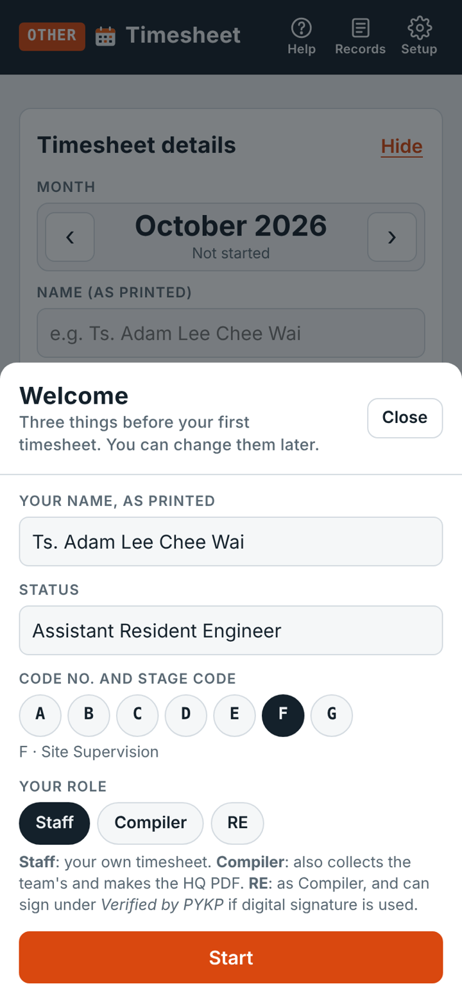

Check the project code at the top left. Tap it to change to another project. **Timesheet details** (tap **Edit**) changes the month, your name, status, codes, and the name block printed above the signature.

## 2. Key in the month

1. Use **‹ ›** in Timesheet details to pick the month.
2. Tap **Fill month**: working days get the normal hours (8.0), Sundays **RD**, public holidays **PH**.

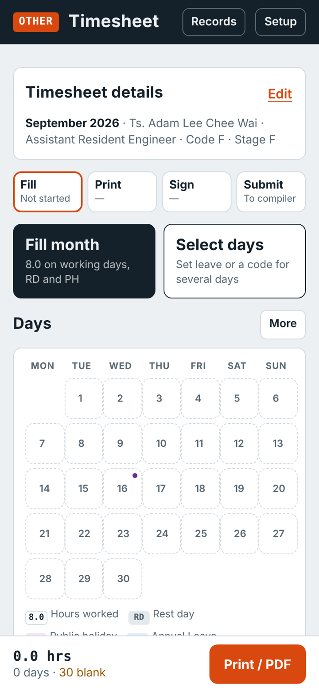&nbsp;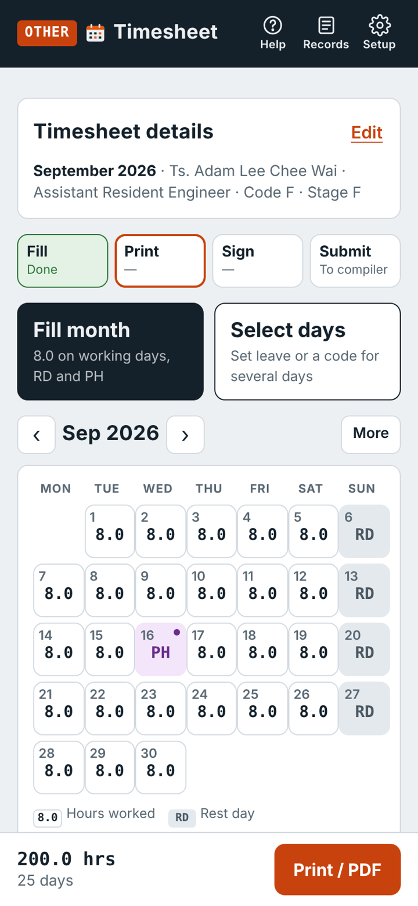

3. **Select days** to set several days at once: tap the days, then a code (e.g. **AL** for annual leave), then **Done**.

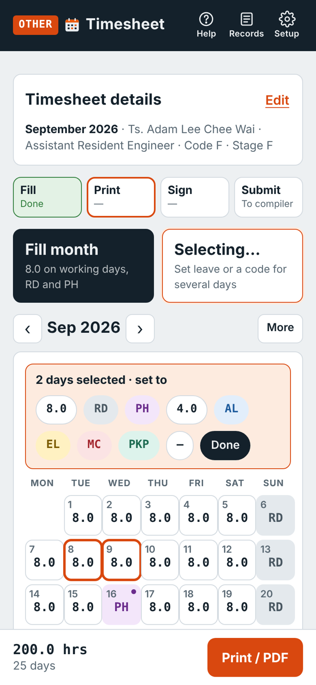

4. Tap any day to change it:
   - **8.0 · RD · PH · 4.0 (half day) · AL · EL · MC · PKP · – (blank)**
   - **Hours worked** for any other number of hours, **Other code** for a code not in the list
   - **Overtime hours** under the right time code: **2** work day, **3** rest day (keep the day as RD), **4** public holiday (keep the day as PH), **5** after midnight
   - **Note for yourself**: not printed; a dot shows on the day
   - **‹ Previous day / Next day ›** to go through the month

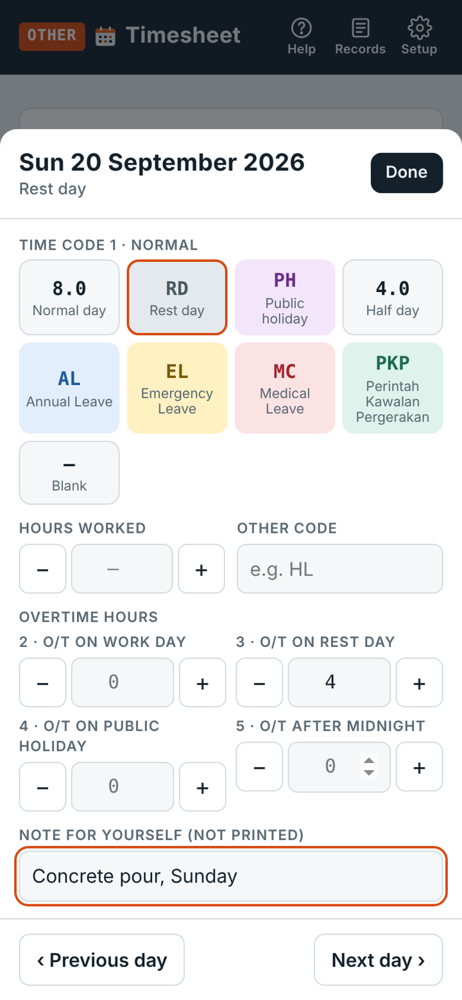

5. **Summary** shows normal hours, overtime, days worked, RD/PH and leave, and lists anything to check (blank days, overtime under the wrong code, hours on a rest day). Tap **Day n** to go straight to it. **Remarks column** (optional) adds text to the form's Remarks column.

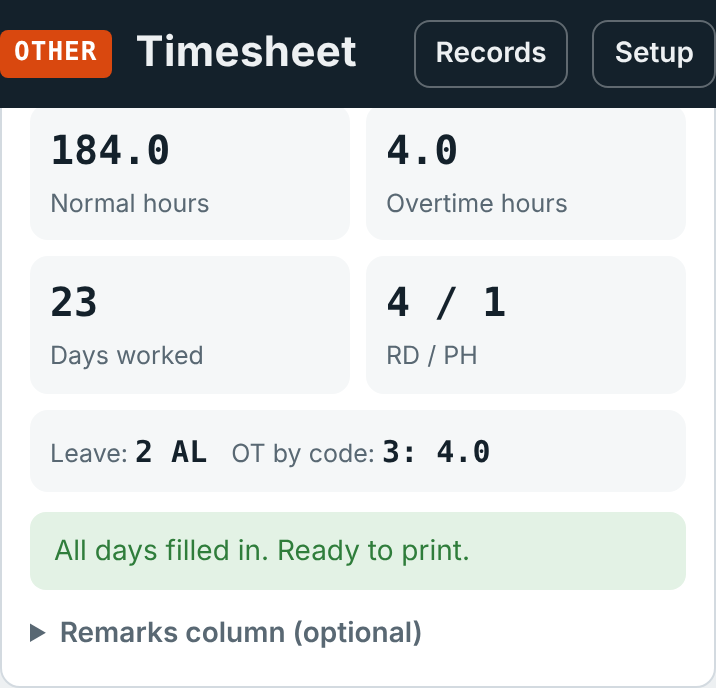

Each code has its own colour on the calendar: **RD** grey, **PH** purple, **AL** blue, **EL** yellow, **MC** red, **PKP** green, any other code brown, a dashed box for a blank day. The legend under the calendar shows them. The printed form is not coloured unless you choose *Colour fill* on the Print / PDF screen (section 3).

Everything is saved on the phone as you go.

## 3. Print

1. Tap **Print / PDF** in the bottom bar. The preview is the A4 page, laid out as the official form; **Zoom** to check the figures.
2. **Colour fill** (optional): *None* (default, as the official form) or *Colour by code*. With colour, the day's column is lightly tinted for RD, PH and leave in the same colours as the calendar, so they stand out from normal working days. The text stays black. Print in colour. The Excel file gets the same fill.
3. **Mark under the form**: *None* (default), *Summary QR* (about 13 mm in the bottom corner, outside the form: project, month, name, designation, normal and OT hours) or *Full QR* (about 28 mm, the whole timesheet). Use what your compiler asks for.
4. **PDF for printing**: **Share** (WhatsApp, e-mail, a printer app), **Save**, or **Open** to print from the viewer. Print on A4 at **actual size (100%)**, not "fit to page".
5. **Excel**: the official spreadsheet form, filled in.

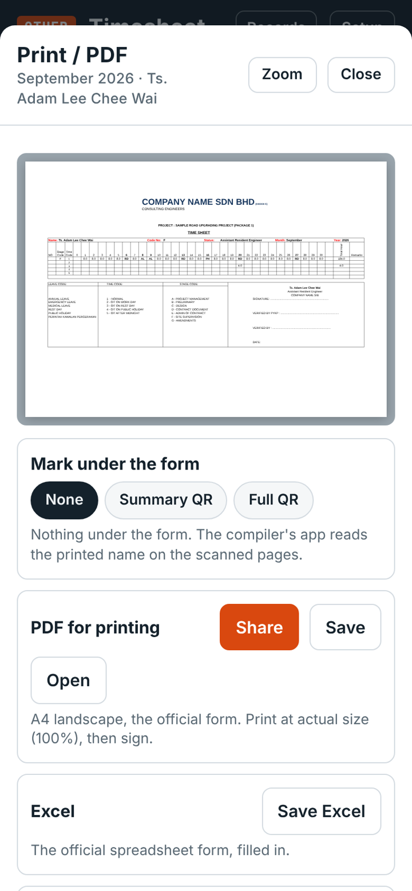&nbsp;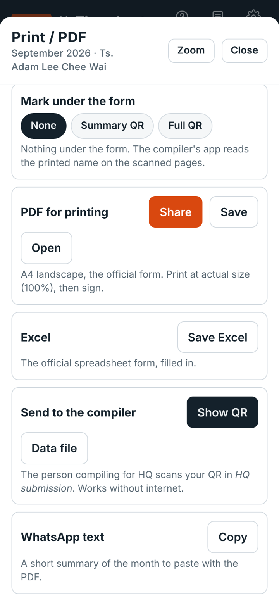

**WhatsApp text → Copy** gives a short summary of the month to paste with the PDF.

## 4. Sign and scan the signed copy

**Sign by hand.** Sign and stamp above *Signature*; the RE signs and stamps at *Verified by PYKP*; the SOR at *Verified by*.

**Scan the signed copy:**

1. In **Sign & signed copy**, tap **Scan signed copy**.
2. Put the sheet on a darker surface. The app outlines the page; tap the round button. (When the live camera is not available, the phone's camera app opens instead.)
3. Drag the four corners to the edges of the sheet if needed (**Whole photo** keeps everything), then **Next**.
4. Choose **B&W** (sharpest), **Grey** or **Colour** (keeps blue ink), rotate if needed, then **Use scan**.

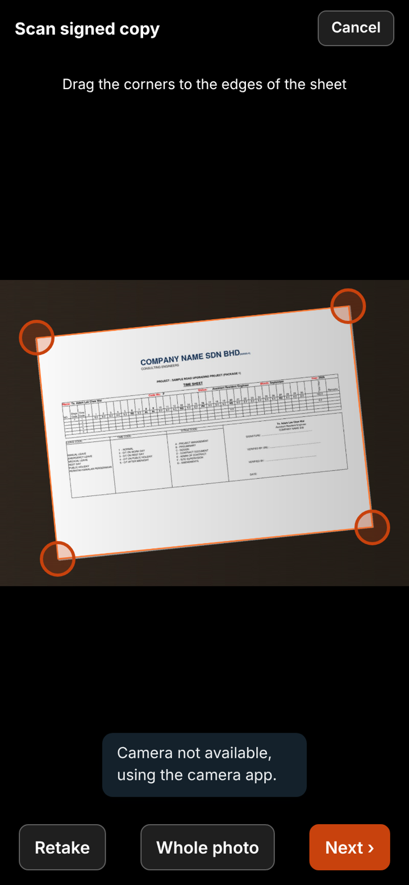&nbsp;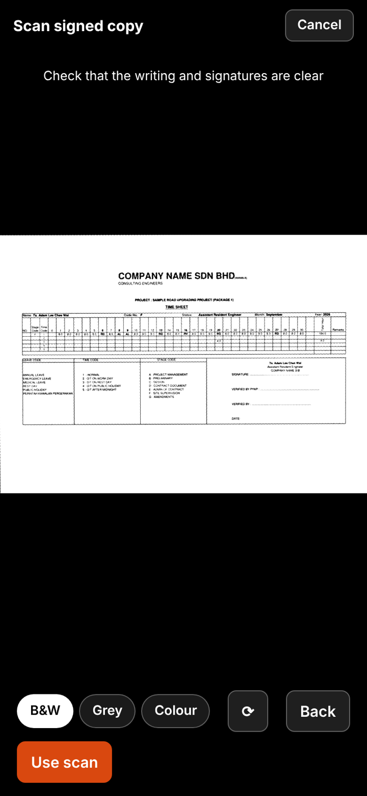

The month is marked **Signed** and the scan is kept on the phone. Tap the thumbnail to view, share or delete it.

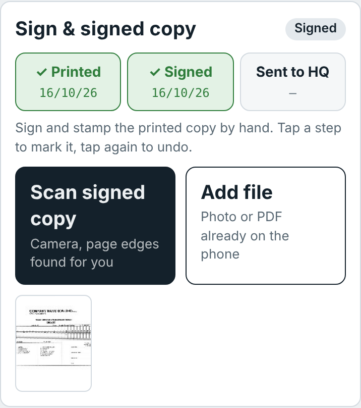

**Status:** tap **Printed**, **Signed** or **Sent to HQ** to mark it; tap again to undo.

**Digital signature (optional, off by default).** The timesheet is normally signed by hand. If your company accepts it, switch it on in **Setup → Digital signature**. Then, in *Sign & signed copy*: **Set up my signature** (draw it, or a photo of it on white paper, with a PIN) → **Sign this month**. **Remove from this month** takes it off one month; **Change or delete my signature** is in the same place. If you change the hours after signing, the signature is taken off until you sign again. **Adjust signature position** (Print / PDF) moves and resizes it.

## 5. Send your timesheet to the compiler

On **Print / PDF**, tap **Show QR**. The compiler scans it with their phone (no internet needed). **Data file** sends the same on WhatsApp instead.

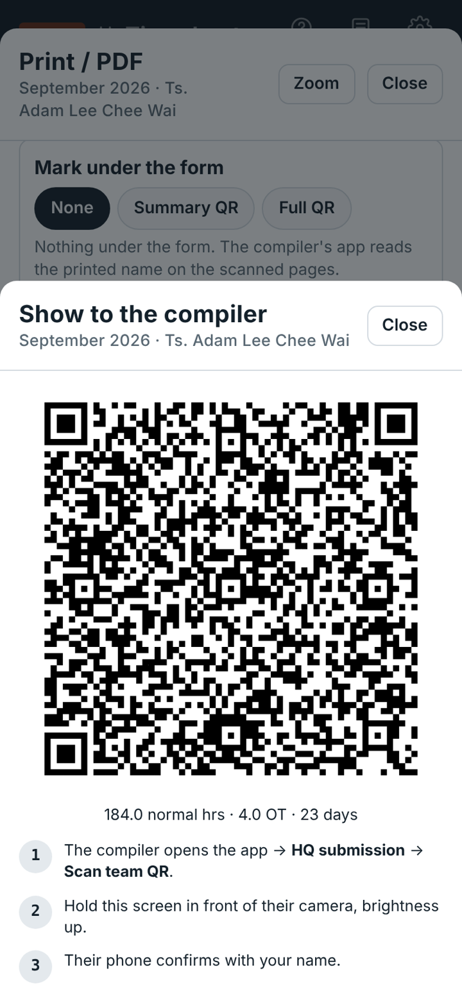

## 6. Records and Setup

**Records** (top right) lists your months with their status and scans; **Open month** goes to it.

**Setup** (top right):

- **Feedback**: send a problem or an idea on WhatsApp; the app version and your phone type are filled in.
- **Your role**: Staff, Compiler or RE.
- **Digital signature** (optional): switch on, set up your signature and PIN, adjust its position.
- **Signature block**: the original form layout (default) or side by side; RE and SOR names printed under their lines; the mark under the form.
- **Project**: the project title on the form, normal hours per day, rest days.
- **Public holidays**: the year's list; remove one, or add a declared special or replacement holiday.
- **Backup**: save your timesheets to a file and restore them on a new phone (scans are not in the backup).
- **Share the app**: QR code and link. **About**: version and credit.

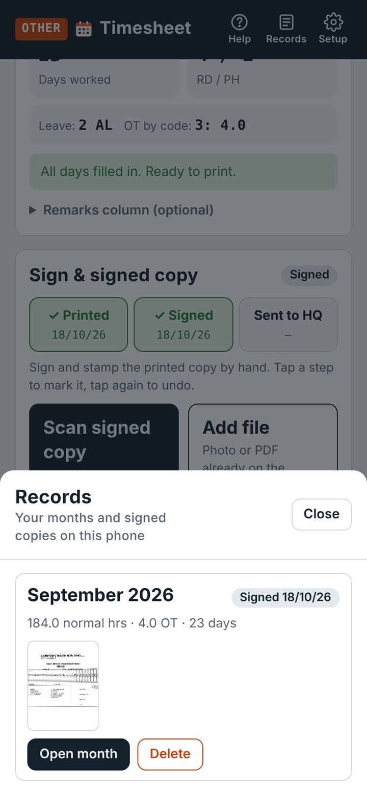&nbsp;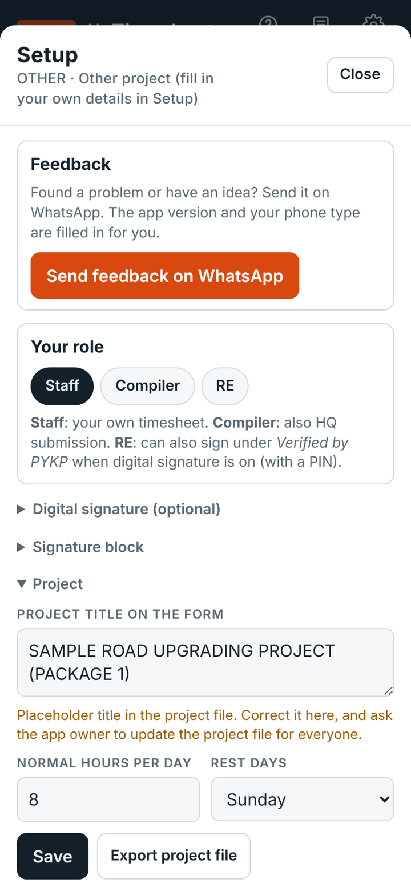

## 7. HQ submission (compiler)

Set your role to **Compiler** or **RE** in Setup. **HQ submission** appears at the bottom of the main screen, with two screens and the monthly steps.

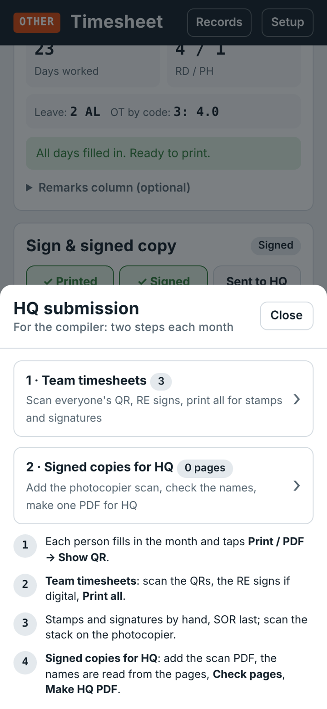

**1 · Team timesheets**

1. **Scan team QR**: each person shows their QR (section 5); the app confirms each name. A printed timesheet's QR works too. **Load data files** reads files sent on WhatsApp; **Add mine** adds your own month.
2. **Colour fill** and **Mark under the printed forms**: the same choices as on Print / PDF, used for everyone's sheet.
3. **Preview**, then **Print all (PDF)**: everyone's timesheet, one page each, ready for stamps and signatures. **One Excel workbook** (a sheet per person) and **Summary CSV** (hours, overtime, leave per person) are there too.

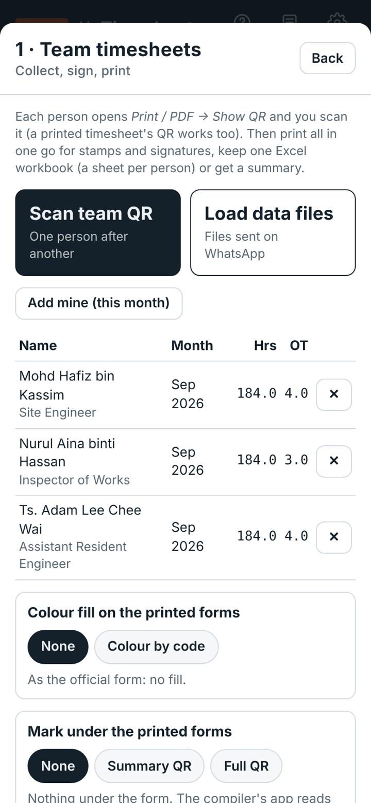

**2 · Signed copies for HQ**

1. After the SOR has signed, scan the whole stack on the photocopier into one PDF and send it to your phone.
2. **Add scan PDF** and pick it. The app reads the printed name on each page and matches it to the team list (pages turned sideways are fine). Pages it cannot read take the remaining names in print order. (Or **Scan pages** with the phone, one sheet after another.)
3. Tap **Check pages**: each page shows a thumbnail, the name line as read, the name, and the **designation, normal hours and OT hours** for the cover page. Correct any page, then **Save**.
   - **Turning pages:** the app turns each scanned timesheet upright and landscape by itself where it can tell (from the printed name or the QR). Use **⟲ / ⟳** under a page to turn it, or **Turn all left / right**. The cover page always stays portrait.
   - Hours come from the team list (QR collected in screen 1) or the summary QR on the page. If a box is empty (*No hours found*) or differs from the signed copy, type the figures from the signed copy. The cover page uses what you typed and marks those hours with **\***.
   - A name not in the team list can be typed in. Clear a box to go back to the automatic value.
4. Set the **timesheet month** and **compiled by**. The ticks below:
   - **Cover page** (on): the list of timesheets with page numbers and the app QR.
   - **Page numbers at the foot of each page** (on): e.g. *Timesheets September 2026 · Page 1 of 12* after the project code. Untick to leave the pages without it.
   - **Cover the QR codes on the scanned pages** (on): once their data has been read, the QR under each form (and the small text beside the full QR) is covered with white in the HQ PDF. The photocopier file itself is not changed.
5. **Preview** shows the cover page and every page; then **Make HQ PDF** and send it to HQ.

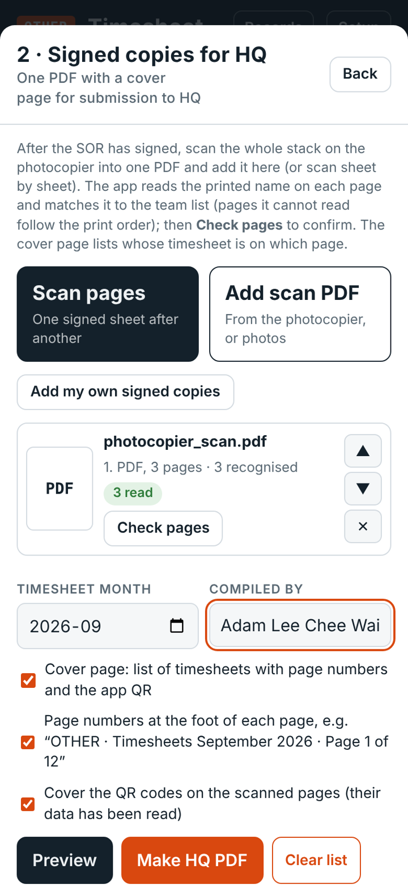&nbsp;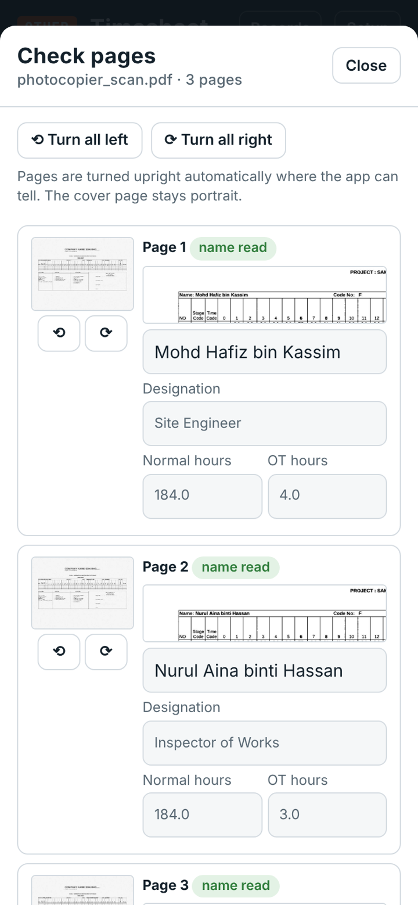

The cover page is generated digitally (no signature needed): the list of timesheets with designation, normal hours, OT, pages and page numbers, anyone still pending, and the app QR. Every page of the HQ PDF is numbered unless you untick the page numbers.

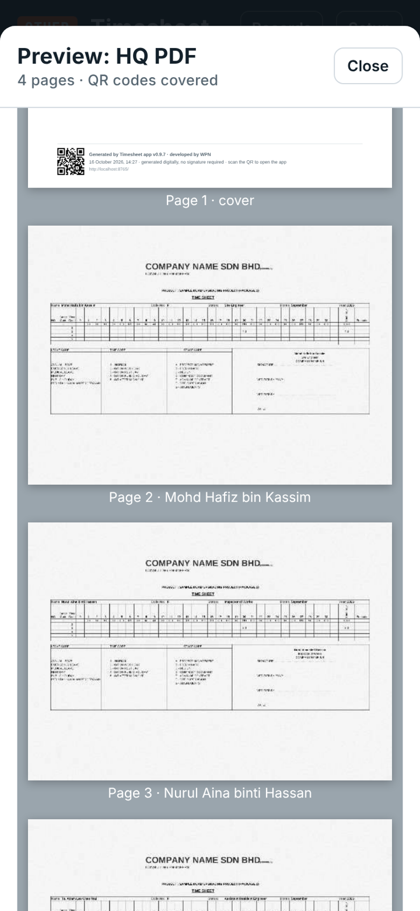

## 8. Good to know

- **Nothing is uploaded.** Timesheets and scans stay on your phone. Back up now and then (Setup → Backup).
- **Works offline** after the first opening with signal.
- **Updates:** open the app with signal; it picks up the new version by itself. If something looks old, close and reopen it.
- **Camera and name reading** need the app opened from its web link (not from a file on a laptop).
- **A wrong public holiday?** Change it in Setup → Public holidays and send feedback so the list is corrected for everyone.
- **Problems or ideas:** Setup → **Send feedback on WhatsApp**.
