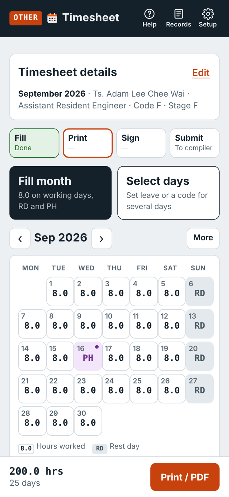

# Timesheet

A web app for the monthly project timesheet. Each staff member keys in the month on the phone, prints the official A4 timesheet for signature, scans the signed copy, and the person compiling puts everyone's signed copies into one PDF for submission to HQ.

It works on iPhone, Android and laptop, in the browser, with nothing to install from an app store, and it keeps working without signal once opened. It can also be opened straight from a folder on a laptop (double-click `index.html`).

**Developed by WPN.** Version 0.9.8 (beta, trial within the team). **New to the app?** Read the [user guide](GUIDE.md). Plan: [ROADMAP.md](ROADMAP.md).

<p></p>

## Why

Filling in the timesheet spreadsheet at the end of the month needs a laptop. The app does the same job on the phone in a couple of minutes, and the printout follows the official form exactly: same columns, codes, header, signature box and A4 landscape print setup.

## What it does

| | |
|---|---|
| **Timesheet details** | Name, status, and **code no. / stage code pickers** (A–G, from the form's legend). Folds away once set. |
| **Fill month** | One tap: normal hours (8.0) on working days, **RD** on rest days and **PH** on public holidays, replacement holidays included. Then change only the days that differ. |
| **Tap a day** | 8.0, RD, PH, half day, AL, EL, MC, PKP, any hours or another code. Overtime under time codes 2–5. A private note per day. |
| **Select days** | Set several days at once, e.g. a week of annual leave. |
| **Checks** | Blank days, overtime under the wrong code, hours on a PH or RD that should be overtime, more than 24 hours in a day, missing details. |
| **Print / PDF** | A4 landscape PDF drawn from the official spreadsheet form: same column widths, borders, header, codes, signature box and print scale. Share, save or open to print. Optional **colour fill**: the day's column tinted for RD, PH and leave (text stays black), also in the Excel file; off by default. |
| **Excel** | The official form itself, filled in: formatting, header, `=SUM()` totals and print setup kept. |
| **Document scanner** | Scan the signed sheet: the live camera finds the page edges, you can drag the corners, and the page is straightened and cleaned up (B&W, grey or colour). |
| **Status** | Printed → Signed → Sent to HQ per month; tap again to undo. **Records** lists every month with its scans. |
| **QR transfer** | Each person shows a QR of their month; the compiler scans it. No internet, no WhatsApp needed. A data file is the second way. |
| **Signature block** | As the original form by default; the RE's and SOR's names can print under their lines. Option: side by side (PYKP beside SOR) for more room for stamps. |
| **Roles** | *Staff*, *Compiler* or *RE* (Setup). Staff see only their own timesheet; the compiler and RE also get HQ submission; only the RE can sign digitally under *Verified by PYKP*, with a PIN. |
| **Digital signature** (optional, off by default) | The timesheet is normally signed by hand. If switched on in Setup: draw your signature or take a photo of it, protected by a PIN. **Sign** puts it on your timesheet; a drawn signature goes with your QR to the RE, who can sign the whole team in one go. A signature is dropped if the hours change after signing. Its position can be dragged and resized. The SOR still signs and stamps the hardcopy. |
| **Scan matching** | No marks on the form: the app reads the printed name on each scanned page (offline text recognition) and matches it to the team list; pages it cannot read follow the print order; **Check pages** to confirm the name, and to type or correct the designation, normal and OT hours for the cover page (marked * when entered by the compiler). Optional mark under the form, chosen on the Print / PDF screen: a **Summary QR** (about 13 mm: project, month, name, designation, normal and OT hours) or a 28 mm full data QR; none by default. |
| **HQ submission** | For the compiler. **1 · Team timesheets**: scan everyone's QR, preview, then print all the timesheets in one PDF for signature, or **one Excel workbook with a sheet per person**, or a summary CSV. **2 · Signed copies**: add the photocopier's scan PDF (or scan sheet by sheet); the names are read from the pages, **Check pages**, preview, then make **one PDF** with a digitally generated cover page (list of timesheets with hours and page numbers, app QR) and numbered pages (optional). Scanned pages are turned upright and landscape automatically (adjust in **Check pages**; the cover stays portrait), and the QR codes on the scans can be covered once read. |
| **Feedback** | *Send feedback on WhatsApp* with the app version and phone type filled in. Set a number in `packages/index.json` (`feedbackWhatsApp`) to send it straight to the app owner. |
| **Help and updates** | **Help** (top right) opens the user guide and change list on GitHub, what's new and feedback. When `version.json` on the site names a newer version, a bar offers **Update now**; *What's new* shows once after an update. The guide links work out the GitHub address from the app's address, or from `repoUrl` in `packages/index.json`. |
| **Delete data** | Delete a month in **Records**; **Setup → Delete data on this phone** to start again. |
| **Works offline** | Once opened, it works without signal. |

## Getting started

1. Open the app's address on your phone.
2. Add it to the home screen:
   - **iPhone (Safari):** Share → *Add to Home Screen*
   - **Android (Chrome):** menu ⋮ → *Install app* or *Add to home screen*
3. In **Timesheet details**, enter your **name as printed** (e.g. *Ts. Adam Lee Chee Wai*), your **status**, and tap your **code no.** and **stage code**.

## Month-end, step by step

1. **Fill month**, then tap the days that were leave, MC or overtime.
2. **Print / PDF** → check the preview → **Share** or **Open** to print. Print on A4 at actual size.
3. Sign, and get the verifying signatures.
4. **Scan signed copy**.
5. Hand in the hardcopy, and **Show QR** to the compiler if asked.
6. The compiler: **HQ submission** → **Scan team QR** for everyone → (only with digital signature on, RE: **Sign all as RE**) → **Print all** → stamps and signatures by hand, SOR last → scan the stack on the photocopier → **Add scan PDF** → **Check pages** → **Preview** → **Share HQ PDF** or **Save** → send to HQ. Mark the month *Sent to HQ*.

## Projects

Tap the project code at the top left to switch. A link can open a project directly: add `?p=<code>` to the app's address.

Projects are files in [`packages/`](packages), listed in [`packages/index.json`](packages/index.json). Each holds the project title printed on the form, the company line under the signature, code no., stage code, normal hours, rest days, signature labels and which holiday list to use. Some project titles are placeholders to confirm (`"toConfirm": true`).

**To correct a project:** open it in the app, **Setup → Project**, edit the title, **Save** (this phone only), then **Export project file**, upload it to `packages/` on GitHub and run `tools/build_data.py` (see below). Everyone gets it the next time they open the app.

**Public holidays** are in [`holidays/`](holidays). Dates marked *sahkan* and the next year's list are provisional: check them against the official gazette and edit the file. Anyone can also add or remove a holiday on their own phone in **Setup → Public holidays**.

## After changing project, holiday or template files

```bash
python3 tools/build_data.py
```

This refreshes `app-data.js`, the packed copy the app uses when `index.html` is opened straight from a folder (the browser blocks reading the separate files there). When the app is served from GitHub Pages it reads the files themselves first.

## If the official form changes

The PDF and Excel output come from one sheet of the official spreadsheet. To follow a new form:

```bash
python3 tools/build_template.py "<timesheet workbook>.xlsx" "<sheet name>"
python3 tools/build_data.py
```

This rewrites `templates/form.xlsx` (the blank form), `templates/form.layout.json` (column widths, row heights, borders, fixed text and header position, for the PDF) and `templates/logo.jpeg`. The cells the app fills keep the same addresses: A12, A15, O15, V15, AD15, AJ15, row 16 day numbers, rows 17–21, AJ/AK, AF25–27 and Z28–Z40.

## Camera

The live document scanner and QR scanner need the app to be opened from its web address (https), as on GitHub Pages. When the app is opened from a file, the phone's camera app is used instead, and a QR is read from a photo.

## Data and privacy

There is no server and no login. Timesheets, signed copy photos and settings stay on the device that made them; nothing is uploaded. **Setup → Backup** saves the timesheets to a file (for a new phone). Clearing the browser's data removes them, so keep the PDFs you send.

## Who can open the app

A GitHub Pages site can be opened by anyone who has its address, even when the repository is private (a private repository with Pages needs a paid GitHub plan). Options for a team-only app:

- **Unlisted address** (simplest): a repository and address with a neutral name, shared only with the team. Not indexed if not linked anywhere, but not protected.
- **Login in front of the site**: host the same files on a service that puts a sign-in in front (e.g. Cloudflare Pages with Cloudflare Access, which lets only listed e-mail addresses in). Strongest option; no change to the app.

Set `appUrl` in `packages/index.json` to the app's address so the HQ cover page QR also works when the PDF is made from a copy opened from a file.

## Publishing on GitHub Pages

1. Create a repository (a neutral name such as `timesheet`) and upload everything in this folder, keeping the folders (`lib/`, `packages/`, `holidays/`, `templates/`).
2. **Settings → Pages → Deploy from a branch → main / (root)**.
3. The app is at `https://<account>.github.io/<repository>/`.
4. After changing files, bump the version in three places together: `APP_BUILD` in `index.html`, `build` in `version.json` and the cache name in `sw.js` (`const C = "ts-v…"`). Phones then show *New version ready*. (`tests/test_qr_rough.py` checks they match.)

## Files

| File | What it is |
|---|---|
| `index.html` | The app |
| `app-data.js` | Packed copy of packages, holidays and templates, made by `tools/build_data.py` |
| `packages/` | Project files and their index |
| `holidays/` | Public holiday lists |
| `templates/` | The blank official form, its print layout and header image (made by `tools/build_template.py`) |
| `lib/` | jsPDF (PDF), JSZip (Excel), pdf-lib (HQ PDF), pdf.js (reading scanned PDFs), Tesseract.js in `lib/tesseract/` (reading the printed names, about 11 MB, loaded only when a scan is added), qrcode-generator (QR codes), jsQR (reading QR codes where the phone has no built-in reader) |
| `manifest.webmanifest`, `sw.js`, `icon-*.png` | Home-screen install and offline use |
| `version.json` | The latest version on the site: the app shows *New version ready* when it is newer than the copy on the phone |
| `tools/` | `build_template.py` and `build_data.py`; `make_guide_shots.py` makes the screenshots in `guide/` |
| `guide/` | Screenshots for the user guide (sample names and letterhead) |
| `tests/test_app.py` | Automatic check: fills a sample month; checks totals, status undo, QR round trip, document scanner steps, PDF, Excel and HQ PDF |
| `tests/test_id_mark.py` | Automatic check: the summary QR stays small (29 × 29 squares, about 13 mm) and its name, designation and hours are read from a noisy 200 dpi scan |
| `tests/test_sign_scan.py` | Automatic check: PIN, roles, signature dropped when hours change, signatures in the QR, PDF and Excel; a simulated 200 dpi photocopier scan recognised page by page and the team list rebuilt from it |
| `tests/test_qr_rough.py` | Automatic check: a rough black-and-white copier scan where the QR may not decode: the QR is still found and blanked, a stamp is left alone; version numbers in `index.html`, `version.json` and `sw.js` match |
| `tests/test_hq_pages.py` | Automatic check: a photocopier scan with pages turned both ways becomes a portrait cover plus upright landscape timesheets; QR codes covered; footer only when ticked |
| `tests/test_color_fill.py` | Automatic check: colour fill off by default; on, the right columns are tinted in the PDF, preview and Excel (borders kept), text stays black |
| `tests/test_cover_edit.py` | Automatic check: the compiler types designation and hours in Check pages; the cover page uses them, marked *; clearing a box restores the automatic value |
| `GUIDE.md`, `ROADMAP.md`, `CHANGELOG.md`, `LICENSE.md` | User guide, trial plan, version history, licence |

## Important

The app prepares the timesheet. The signed hardcopy is the record. Check the public holidays and any replacement days declared during the year.

## Ringkasan (BM)

Aplikasi web untuk timesheet bulanan. Isi timesheet di telefon (isi bulan dengan satu tekan, tukar hari cuti, MC atau kerja lebih masa), cetak timesheet rasmi A4 mengikut format borang untuk ditandatangani, simpan foto salinan bertandatangan, imbas salinan bertandatangan, dan kumpulkan salinan seluruh pasukan dalam satu PDF untuk dihantar ke HQ. Semua data disimpan dalam peranti pengguna sendiri.

---

Licence: see [LICENSE.md](LICENSE.md). © 2026 WPN.
